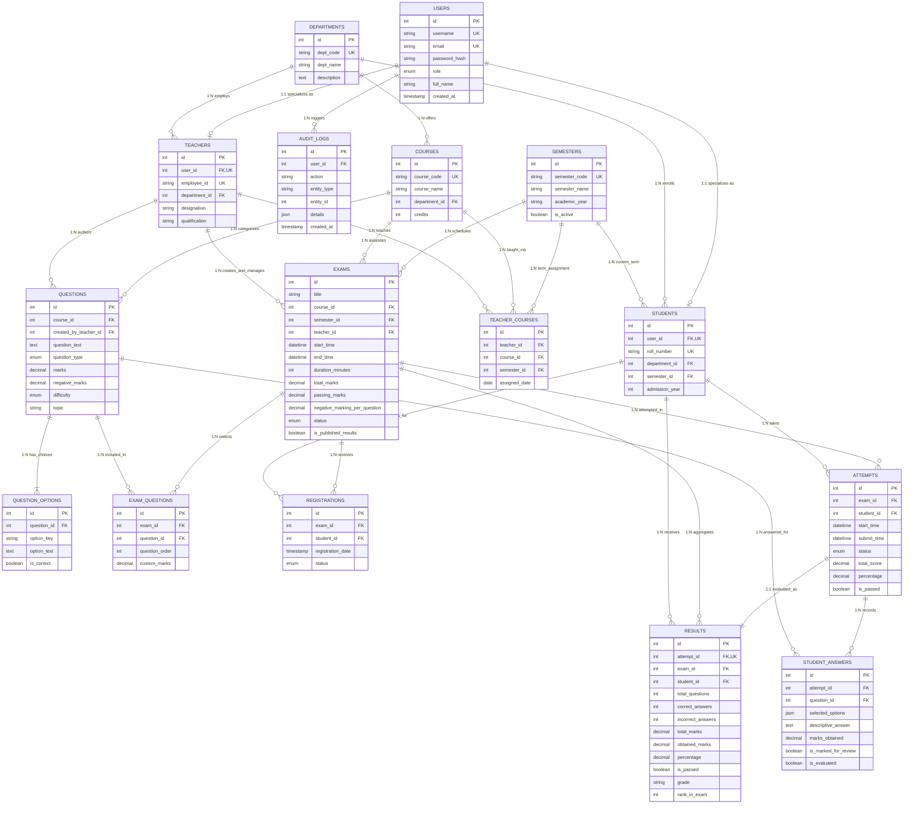

# EXAMORA: Entity-Relationship (ER) Model & Relational Schema Mapping
## Formal DBMS Conceptual, Logical, and Physical Design

---

### 1. Conceptual ER Diagram (Mermaid)

---

### 2. Relationship Cardinalities and Structural Constraints

#### A. One-to-One Relationships (1:1)
1. **`users` to `students` (1:1 Partial Specialization):**
   - Each student record corresponds to exactly one user record (`user_id` has a `UNIQUE` constraint).
   - Not all users are students (some are teachers or admins).
2. **`users` to `teachers` (1:1 Partial Specialization):**
   - Each teacher corresponds to exactly one user record (`user_id` has a `UNIQUE` constraint).
3. **`attempts` to `results` (1:1 Total / Partial Specialization):**
   - An evaluated attempt yields exactly one result row (`attempt_id` has a `UNIQUE` constraint in `results`).
   - A fresh `in_progress` attempt has not yet produced a final result until submitted/evaluated.

#### B. One-to-Many Relationships (1:N)
1. **`departments` to `students` (1:N):**
   - One department enrolls many students. Each student belongs to exactly one department (`ON DELETE RESTRICT` protects academic records).
2. **`departments` to `teachers` (1:N):**
   - One department employs many faculty members.
3. **`departments` to `courses` (1:N):**
   - One department offers multiple academic courses.
4. **`courses` to `exams` (1:N):**
   - A course can have multiple midterms, quizzes, and final exams.
5. **`exams` to `attempts` (1:N):**
   - An exam is attempted by multiple students.
6. **`questions` to `question_options` (1:N):**
   - A single MCQ or True/False question possesses multiple distinct options (e.g., A, B, C, D).

#### C. Many-to-Many Relationships (M:N) Resolved via Associative Entities
1. **`teachers` and `courses` (M:N):**
   - A teacher can teach multiple courses; a course can be taught by multiple teachers across different semesters.
   - **Associative Entity:** `teacher_courses` with composite unique constraint `(teacher_id, course_id, semester_id)`.
2. **`exams` and `questions` (M:N):**
   - An examination comprises multiple questions; questions from the question bank can appear in multiple examinations.
   - **Associative Entity:** `exam_questions` with composite unique constraint `(exam_id, question_id)` and order tracking `question_order`.
3. **`exams` and `students` (M:N):**
   - A student registers for and attempts multiple exams; an exam has registrations and attempts from multiple students.
   - **Associative Entities:** `registrations` and `attempts`.
4. **`attempts` and `questions` (M:N):**
   - An attempt contains responses to multiple questions.
   - **Associative Entity:** `student_answers` with composite unique constraint `(attempt_id, question_id)`.

---

### 3. Referential Integrity Policy

| Child Table | Foreign Key Column | Parent Table | On Delete | On Update | Reason |
| :--- | :--- | :--- | :--- | :--- | :--- |
| `students` | `department_id` | `departments` | `RESTRICT` | `CASCADE` | Cannot delete department with enrolled students |
| `teachers` | `department_id` | `departments` | `RESTRICT` | `CASCADE` | Cannot delete department with active faculty |
| `courses` | `department_id` | `departments` | `CASCADE` | `CASCADE` | Course lifecycle follows academic department |
| `exams` | `course_id` | `courses` | `CASCADE` | `CASCADE` | Exams belong directly to course syllabus |
| `exams` | `teacher_id` | `teachers` | `RESTRICT` | `CASCADE` | Exam papers require instructor accountability |
| `attempts` | `exam_id` | `exams` | `CASCADE` | `CASCADE` | Deleting exam cascade cleans student attempts |
| `student_answers`| `attempt_id` | `attempts` | `CASCADE` | `CASCADE` | Answers exist only within an attempt session |
| `results` | `attempt_id` | `attempts` | `CASCADE` | `CASCADE` | Scorecards tied to attempt session |
| `audit_logs` | `user_id` | `users` | `SET NULL` | `CASCADE` | Retain security audit trails even if user is pruned |

